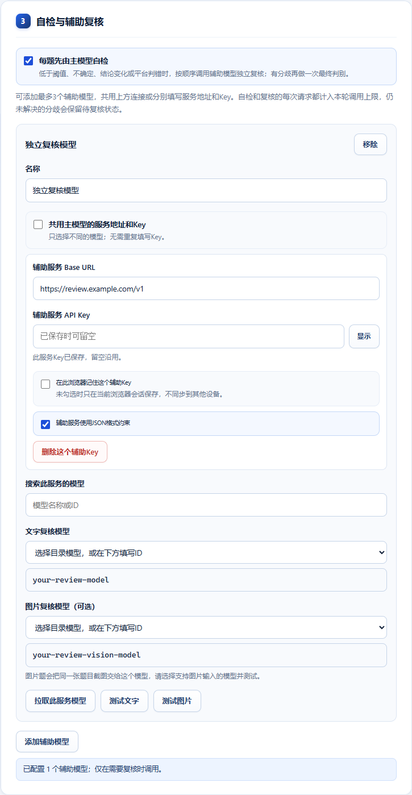

# 课伴 · Study Pilot Edge

面向 Microsoft Edge 的课程学习助手，支持学习通与中国大学 MOOC。使用者接入自己的 OpenAI 兼容服务，自选文字和图片模型，进行图文解析、正常音视频续播、课件浏览和章节导航。

**当前版本：v0.7.0**。扩展无运行时 npm/Python 依赖；首次安装没有 Key、账号、模型或课程目标。

## 安装

1. 从 [Releases](https://github.com/tg56y2p4/study-pilot-edge/releases) 下载 `study-pilot-edge-v0.7.0.zip` 并解压。
2. Edge 打开 `edge://extensions`，开启“开发人员模式”。
3. 点击“加载解压缩的扩展”，选择直接包含 `manifest.json` 的文件夹。使用仓库源码时选择 `extension/`。
4. 打开课伴设置，填写自己的 API Key 与 API Host / Base URL，拉取模型，分别选择文字与图片模型并测试。
5. 本人在浏览器登录课程平台，打开课程，从课伴工具栏开始本轮托管。

安装文件夹需保留。更新后重新加载扩展并刷新课程页；有未提交答案时，先在平台保存或处理。

## 自选模型

“连接服务 → 选择模型 → 测试并保存”三步配置。支持模型目录搜索、文字/图片模型分选、同模型跟随，以及未开放目录时手填模型 ID。修改接入信息会取消旧目录请求；不同服务来源不会沿用旧 Key。



模型服务需支持 OpenAI 兼容 Chat Completions。目录声明不等于调用权限或图片能力，使用前完成文字和图片测试。原生 Anthropic Messages 当前不是直接接入协议。

[接入配置与模型说明](docs/CONFIGURATION.md) · [常见问题](docs/TROUBLESHOOTING.md)

## 支持的课程操作

- 正常音视频播放与续播，完成当前任务后导航到后续单元。
- 学习通嵌套框架题目、图文解析、可选填写、章节练习提交与确认。
- MOOC“我的课程”、新标签接管、视频/课件/随堂练习混合导航、PDF翻页与延迟章节目录。
- 学习通视频中途的随堂弹窗题：定时轮询检测，自动作答、提交并继续播放。
- 自检与自动恢复：长时间无响应时刷新页面，并检查课程或章节是否已全部学完。
- MOOC待办分类、逐项入口及停止状态下的完成复查。
- 接口调用次数、填写阈值、静音、课程目标和阅读间隔等行为设置。

支持单选、多选、判断、普通填空和简答，复杂交互需具体适配。模型答案和自评分数可能出错，不代表保证正确率。课程平台页面变化可能影响适配。

## 本人操作与待办

验证码、考试、独立完成声明及课程讨论保留给本人按平台要求处理。每项待办显示原因与入口；平台出现提交/成绩记录或确认本人回复后，插件再清除对应待办。已浏览、草稿和其他人的回复不算完成。

“停止”取消后续自动操作；需要暂停视频时，再使用播放器按钮。插件不跳过播放时间、不伪造学习记录，也不执行模型返回的任意代码。

## 数据与权限

Key 默认只保留本次浏览器会话；可选择在本机扩展存储中记住。存储不跨设备同步，未自行加密。模型请求直接发送到你选择的服务，可能包含题目、选项与必要截图；请阅读 [数据与权限说明](docs/PRIVACY.md)。

仓库和安装包不包含个人账号、Key、浏览器配置、本机自动登录工具或真实课程测试记录。截图权限可能使 Edge 显示调试提示。

## 开发与构建

需要 Node.js 22+、Python 3.11+。安装插件本身不需要这两个环境。

```sh
npm ci --ignore-scripts
python -m pip install -r requirements-dev.txt
python -m playwright install chromium
npm run check
npm run test:unit
npm run test:release
python tools/run_browser_checks.py --browser chromium --jobs 2
npm run build
```

所有公开自动检查使用模拟 API 和离线课程，不需要真实账号或 Key。构建会核对当前源码对应的完整检查，生成安装包、源码包及 `SHA256SUMS.txt`。源码白名单用于防止把本机资料带入发布包。

[开发说明](docs/DEVELOPMENT.md) · [发布说明](docs/RELEASING.md) · [更新记录](CHANGELOG.md)

## 反馈与许可证

反馈问题请提供版本、复现步骤和无敏感信息的截图，勿提交 Key、Cookie、密码或带签名的课程链接。参阅 [参与开发](CONTRIBUTING.md) 与 [安全反馈](SECURITY.md)。

**许可证尚未选定。** 仓库公开源码，目前没有声明 MIT、GPL 等开源复用授权。
